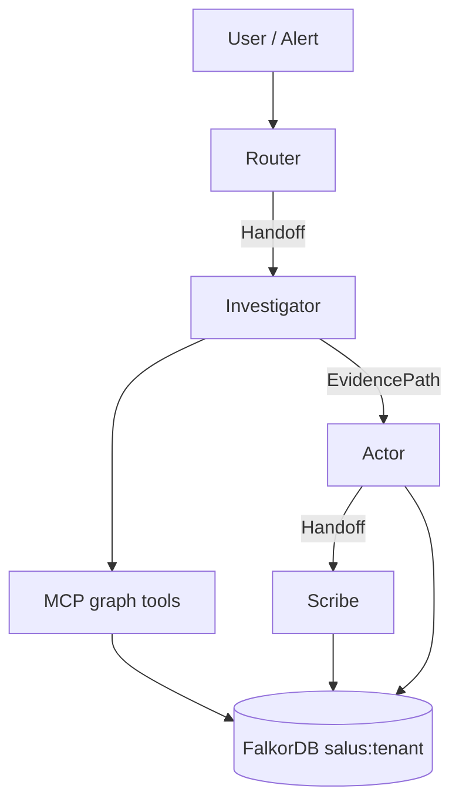

# SALUS architecture

## Domains

One schema. Systems carry `domain`:
`finance` | `healthcare` | `security` | `facilities` | `ops` | custom

## Stack

- FalkorDB Docker (`docker compose up -d`)
- Python `falkordb` client
- Multi-agent loop in `salus/agents.py`
- MCP server in `salus/mcp_server.py`
